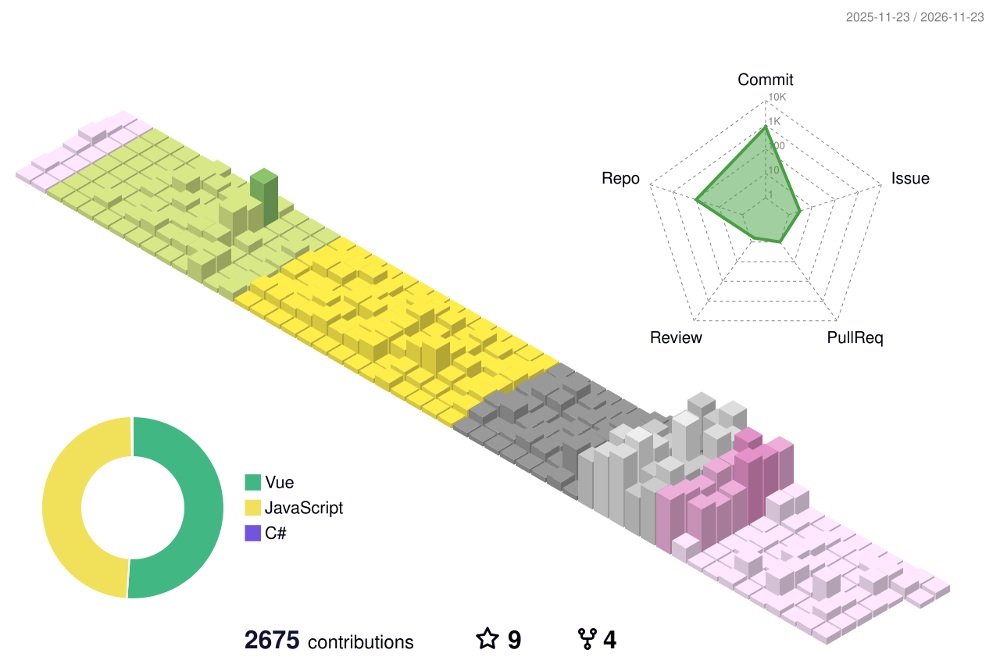

English | [中文](README_CN.md)

[](https://git.io/typing-svg)

<div style="display: grid;gap: 20px;grid-template-columns: repeat(auto-fit, minmax(240px, 1fr));">

<div>

- 🔭 I’m currently working on maui-related
- 🌱 I’m currently learning 微信小程序开发
- 👯 I’m looking to collaborate on 副业
- 🤔 I’m looking for help with ...
- 💬 Ask me about ...
- 📫 How to reach me: changweihua@outlook.com
- 😄 Pronouns: ...
- ⚡ Fun fact: ...

</div>

</div>

#### :bar_chart: [月度工分](https://github.com/changweihua/wakapi)

<!--START_SECTION:wakao-->

```txt
Kotlin            20 hrs 50 mins        🟩🟩🟩🟩🟩🟩🟩🟨⬜⬜⬜⬜⬜⬜⬜⬜⬜⬜⬜⬜⬜⬜⬜⬜⬜   29.50 %
Java              18 hrs 45 mins        🟩🟩🟩🟩🟩🟩🟨⬜⬜⬜⬜⬜⬜⬜⬜⬜⬜⬜⬜⬜⬜⬜⬜⬜⬜   26.56 %
XML               13 hrs 23 mins        🟩🟩🟩🟩🟨⬜⬜⬜⬜⬜⬜⬜⬜⬜⬜⬜⬜⬜⬜⬜⬜⬜⬜⬜⬜   18.97 %
Markdown          7 hrs 47 mins         🟩🟩🟩⬜⬜⬜⬜⬜⬜⬜⬜⬜⬜⬜⬜⬜⬜⬜⬜⬜⬜⬜⬜⬜⬜   11.03 %
TypeScript        2 hrs 32 mins         🟩⬜⬜⬜⬜⬜⬜⬜⬜⬜⬜⬜⬜⬜⬜⬜⬜⬜⬜⬜⬜⬜⬜⬜⬜   03.61 %
```

<!--END_SECTION:wakao-->


#### Contrib ####

<!--   profile-green-animate -->


<!--START_SECTION:waka-->


**我是早鸟 🐤** 

```text
🌞 早晨                     4582 commits        █████████░░░░░░░░░░░░░░░░   37.92 % 
🌆 白天                     4716 commits        ██████████░░░░░░░░░░░░░░░   39.03 % 
🌃 傍晚                     2571 commits        █████░░░░░░░░░░░░░░░░░░░░   21.28 % 
🌙 晚上                     215 commits         ░░░░░░░░░░░░░░░░░░░░░░░░░   01.78 % 
```
📅 **星期二 时的我最有干劲** 

```text
星期一                      1834 commits        ████░░░░░░░░░░░░░░░░░░░░░   15.18 % 
星期二                      2060 commits        ████░░░░░░░░░░░░░░░░░░░░░   17.05 % 
星期三                      2055 commits        ████░░░░░░░░░░░░░░░░░░░░░   17.01 % 
星期四                      1867 commits        ████░░░░░░░░░░░░░░░░░░░░░   15.45 % 
星期五                      1980 commits        ████░░░░░░░░░░░░░░░░░░░░░   16.39 % 
星期六                      1232 commits        ███░░░░░░░░░░░░░░░░░░░░░░   10.20 % 
星期日                      1056 commits        ██░░░░░░░░░░░░░░░░░░░░░░░   08.74 % 
```


📊 **本周消耗时间** 

```text
🕑︎ 时区: Asia/Shanghai

💬 编程语言: 
Kotlin                   9 hrs 13 mins       ███████████░░░░░░░░░░░░░░   45.30 % 
Java                     3 hrs 50 mins       █████░░░░░░░░░░░░░░░░░░░░   18.86 % 
XML                      2 hrs 3 mins        ███░░░░░░░░░░░░░░░░░░░░░░   10.11 % 
Markdown                 2 hrs               ██░░░░░░░░░░░░░░░░░░░░░░░   09.84 % 
TypeScript               1 hr 30 mins        ██░░░░░░░░░░░░░░░░░░░░░░░   07.41 % 

🔥 编辑器: 
Android Studio           13 hrs 30 mins      █████████████████░░░░░░░░   66.37 % 
VS Code                  2 hrs 39 mins       ███░░░░░░░░░░░░░░░░░░░░░░   13.08 % 
OpenCode                 1 hr 41 mins        ██░░░░░░░░░░░░░░░░░░░░░░░   08.29 % 
Visual Studio            1 hr 15 mins        ██░░░░░░░░░░░░░░░░░░░░░░░   06.21 % 
IntelliJ IDEA            1 hr 13 mins        ██░░░░░░░░░░░░░░░░░░░░░░░   06.05 % 

🐱‍💻 项目: 
rfidTrack                12 hrs 45 mins      ████████████████░░░░░░░░░   62.66 % 
quiz                     3 hrs 43 mins       █████░░░░░░░░░░░░░░░░░░░░   18.27 % 
WorkPulse                2 hrs               ██░░░░░░░░░░░░░░░░░░░░░░░   09.89 % 
DeepSeekSolution         1 hr 12 mins        █░░░░░░░░░░░░░░░░░░░░░░░░   05.90 % 
changweihua.github.io    26 mins             █░░░░░░░░░░░░░░░░░░░░░░░░   02.19 % 

💻 操作系统: 
Windows                  20 hrs 21 mins      █████████████████████████   100.00 % 
```

🤖 **AI Coding This Week** 

```text
⏱ AI Coding Time: 5 hrs 54 mins (29.02%)

✍️ 5,985 lines written by AI, 2,314 lines written by hand (72.12% AI-written)

🔤 5,350,614 Input Tokens, 606,045 Output Tokens

💵 $179.21 Estimated AI Cost This Week

🧠 7 AI Sessions, 35 AI Prompts

U                        6,106 lines         █████████████████████████   100.00 % 

🔎 AI Coding Insights:
🤖 AI-Driven — 72.12% of written lines came from AI
📄 Detailed Prompter — average 1,445 characters per prompt
🔁 Iterative Prompter — average 5 prompts per session
🚀 High AI Trust — 42.23% of changed lines were hand-edited
```

**我最常使用 C#** 

```text
C#                       57 repos            ██████████░░░░░░░░░░░░░░░   41.61 % 
TypeScript               20 repos            ████░░░░░░░░░░░░░░░░░░░░░   14.60 % 
JavaScript               18 repos            ███░░░░░░░░░░░░░░░░░░░░░░   13.14 % 
Java                     6 repos             █░░░░░░░░░░░░░░░░░░░░░░░░   04.38 % 
Python                   1 repo              ░░░░░░░░░░░░░░░░░░░░░░░░░   00.73 % 
```


<!--END_SECTION:waka-->


<!--  -->
