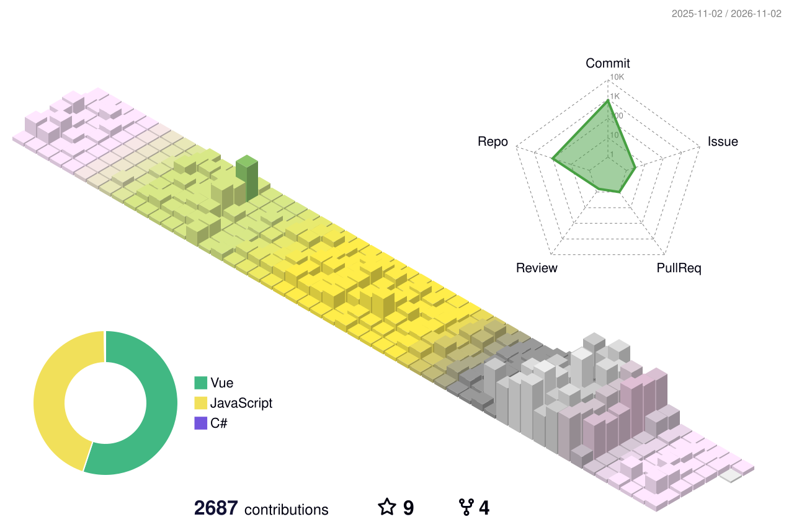

English | [中文](README_CN.md)

[](https://git.io/typing-svg)

<div style="display: grid;gap: 20px;grid-template-columns: repeat(auto-fit, minmax(240px, 1fr));">

<div>

- 🔭 I’m currently working on maui-related
- 🌱 I’m currently learning 微信小程序开发
- 👯 I’m looking to collaborate on 副业
- 🤔 I’m looking for help with ...
- 💬 Ask me about ...
- 📫 How to reach me: changweihua@outlook.com
- 😄 Pronouns: ...
- ⚡ Fun fact: ...

</div>

</div>

#### :bar_chart: [月度工分](https://github.com/changweihua/wakapi)

<!--START_SECTION:wakao-->

```txt
Java              17 hrs 2 mins         🟩🟩🟩🟩🟩🟩🟩⬜⬜⬜⬜⬜⬜⬜⬜⬜⬜⬜⬜⬜⬜⬜⬜⬜⬜   28.31 %
Kotlin            13 hrs 4 mins         🟩🟩🟩🟩🟩🟨⬜⬜⬜⬜⬜⬜⬜⬜⬜⬜⬜⬜⬜⬜⬜⬜⬜⬜⬜   21.71 %
XML               12 hrs 3 mins         🟩🟩🟩🟩🟩⬜⬜⬜⬜⬜⬜⬜⬜⬜⬜⬜⬜⬜⬜⬜⬜⬜⬜⬜⬜   20.02 %
Markdown          7 hrs 16 mins         🟩🟩🟩⬜⬜⬜⬜⬜⬜⬜⬜⬜⬜⬜⬜⬜⬜⬜⬜⬜⬜⬜⬜⬜⬜   12.09 %
C#                3 hrs 17 mins         🟩🟨⬜⬜⬜⬜⬜⬜⬜⬜⬜⬜⬜⬜⬜⬜⬜⬜⬜⬜⬜⬜⬜⬜⬜   05.46 %
```

<!--END_SECTION:wakao-->


#### Contrib ####

<!--   profile-green-animate -->


<!--START_SECTION:waka-->


**我是早鸟 🐤** 

```text
🌞 早晨                     4706 commits        █████████░░░░░░░░░░░░░░░░   36.94 % 
🌆 白天                     5103 commits        ██████████░░░░░░░░░░░░░░░   40.05 % 
🌃 傍晚                     2697 commits        █████░░░░░░░░░░░░░░░░░░░░   21.17 % 
🌙 晚上                     234 commits         ░░░░░░░░░░░░░░░░░░░░░░░░░   01.84 % 
```
📅 **星期二 时的我最有干劲** 

```text
星期一                      1944 commits        ████░░░░░░░░░░░░░░░░░░░░░   15.26 % 
星期二                      2207 commits        ████░░░░░░░░░░░░░░░░░░░░░   17.32 % 
星期三                      2190 commits        ████░░░░░░░░░░░░░░░░░░░░░   17.19 % 
星期四                      2005 commits        ████░░░░░░░░░░░░░░░░░░░░░   15.74 % 
星期五                      2089 commits        ████░░░░░░░░░░░░░░░░░░░░░   16.40 % 
星期六                      1243 commits        ██░░░░░░░░░░░░░░░░░░░░░░░   09.76 % 
星期日                      1062 commits        ██░░░░░░░░░░░░░░░░░░░░░░░   08.34 % 
```


📊 **本周消耗时间** 

```text
🕑︎ 时区: Asia/Shanghai

💬 编程语言: 
Kotlin                   10 hrs 13 mins      ██████████░░░░░░░░░░░░░░░   39.15 % 
Java                     5 hrs 8 mins        █████░░░░░░░░░░░░░░░░░░░░   19.68 % 
XML                      4 hrs 3 mins        ████░░░░░░░░░░░░░░░░░░░░░   15.56 % 
Markdown                 3 hrs 56 mins       ████░░░░░░░░░░░░░░░░░░░░░   15.09 % 
TypeScript               44 mins             █░░░░░░░░░░░░░░░░░░░░░░░░   02.84 % 

🔥 编辑器: 
Android Studio           20 hrs 16 mins      ███████████████████░░░░░░   77.69 % 
VS Code                  4 hrs 14 mins       ████░░░░░░░░░░░░░░░░░░░░░   16.27 % 
Visual Studio            1 hr 22 mins        █░░░░░░░░░░░░░░░░░░░░░░░░   05.24 % 
OpenCode                 12 mins             ░░░░░░░░░░░░░░░░░░░░░░░░░   00.81 % 

🐱‍💻 项目: 
rfidTrack                17 hrs 30 mins      █████████████████░░░░░░░░   67.07 % 
quiz                     3 hrs 51 mins       ████░░░░░░░░░░░░░░░░░░░░░   14.80 % 
changweihua.github.io    3 hrs 2 mins        ███░░░░░░░░░░░░░░░░░░░░░░   11.66 % 
DeepSeekSolution         51 mins             █░░░░░░░░░░░░░░░░░░░░░░░░   03.28 % 
WorkPulse                48 mins             █░░░░░░░░░░░░░░░░░░░░░░░░   03.10 % 

💻 操作系统: 
Windows                  26 hrs 6 mins       █████████████████████████   100.00 % 
```

🤖 **AI Coding This Week** 

```text
⏱ AI Coding Time: 6 hrs 3 mins (23.2%)

✍️ 3,233 lines written by AI, 3,088 lines written by hand (51.15% AI-written)

🔤 4,952,847 Input Tokens, 685,547 Output Tokens

💵 $161.92 Estimated AI Cost This Week

🧠 15 AI Sessions, 97 AI Prompts

U                        3,256 lines         █████████████████████████   100.00 % 

🔎 AI Coding Insights:
⚖️ Balanced with AI — 51.15% of written lines came from AI
📝 Concise Prompter — average 61 characters per prompt
🔁 Iterative Prompter — average 6 prompts per session
🔍 Hands-On Reviewer — 54.3% of changed lines were hand-edited
```

**我最常使用 C#** 

```text
C#                       57 repos            ██████████░░░░░░░░░░░░░░░   41.61 % 
TypeScript               20 repos            ████░░░░░░░░░░░░░░░░░░░░░   14.60 % 
JavaScript               18 repos            ███░░░░░░░░░░░░░░░░░░░░░░   13.14 % 
Java                     6 repos             █░░░░░░░░░░░░░░░░░░░░░░░░   04.38 % 
Python                   1 repo              ░░░░░░░░░░░░░░░░░░░░░░░░░   00.73 % 
```


<!--END_SECTION:waka-->


<!--  -->
