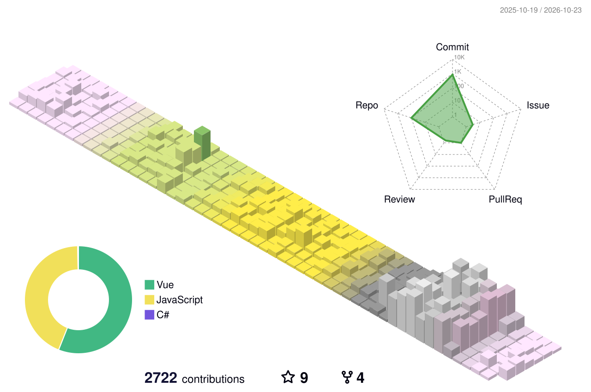

English | [中文](README_CN.md)

[](https://git.io/typing-svg)

<div style="display: grid;gap: 20px;grid-template-columns: repeat(auto-fit, minmax(240px, 1fr));">

<div>

- 🔭 I’m currently working on maui-related
- 🌱 I’m currently learning 微信小程序开发
- 👯 I’m looking to collaborate on 副业
- 🤔 I’m looking for help with ...
- 💬 Ask me about ...
- 📫 How to reach me: changweihua@outlook.com
- 😄 Pronouns: ...
- ⚡ Fun fact: ...

</div>

</div>

#### :bar_chart: [月度工分](https://github.com/changweihua/wakapi)

<!--START_SECTION:wakao-->

```txt
Markdown          3 hrs 29 mins         🟩🟩🟩🟩🟩🟩⬜⬜⬜⬜⬜⬜⬜⬜⬜⬜⬜⬜⬜⬜⬜⬜⬜⬜⬜   23.90 %
Java              3 hrs 28 mins         🟩🟩🟩🟩🟩🟩⬜⬜⬜⬜⬜⬜⬜⬜⬜⬜⬜⬜⬜⬜⬜⬜⬜⬜⬜   23.78 %
XML               1 hr 57 mins          🟩🟩🟩🟨⬜⬜⬜⬜⬜⬜⬜⬜⬜⬜⬜⬜⬜⬜⬜⬜⬜⬜⬜⬜⬜   13.43 %
JSON              1 hr 45 mins          🟩🟩🟩⬜⬜⬜⬜⬜⬜⬜⬜⬜⬜⬜⬜⬜⬜⬜⬜⬜⬜⬜⬜⬜⬜   12.00 %
C#                1 hr 26 mins          🟩🟩🟨⬜⬜⬜⬜⬜⬜⬜⬜⬜⬜⬜⬜⬜⬜⬜⬜⬜⬜⬜⬜⬜⬜   09.92 %
```

<!--END_SECTION:wakao-->


#### Contrib ####

<!--   profile-green-animate -->


<!--START_SECTION:waka-->


**我是早鸟 🐤** 

```text
🌞 早晨                     4587 commits        █████████░░░░░░░░░░░░░░░░   36.97 % 
🌆 白天                     4941 commits        ██████████░░░░░░░░░░░░░░░   39.83 % 
🌃 傍晚                     2658 commits        █████░░░░░░░░░░░░░░░░░░░░   21.43 % 
🌙 晚上                     220 commits         ░░░░░░░░░░░░░░░░░░░░░░░░░   01.77 % 
```
📅 **星期二 时的我最有干劲** 

```text
星期一                      1897 commits        ████░░░░░░░░░░░░░░░░░░░░░   15.29 % 
星期二                      2140 commits        ████░░░░░░░░░░░░░░░░░░░░░   17.25 % 
星期三                      2122 commits        ████░░░░░░░░░░░░░░░░░░░░░   17.10 % 
星期四                      1929 commits        ████░░░░░░░░░░░░░░░░░░░░░   15.55 % 
星期五                      2031 commits        ████░░░░░░░░░░░░░░░░░░░░░   16.37 % 
星期六                      1237 commits        ██░░░░░░░░░░░░░░░░░░░░░░░   09.97 % 
星期日                      1050 commits        ██░░░░░░░░░░░░░░░░░░░░░░░   08.46 % 
```


📊 **本周消耗时间** 

```text
🕑︎ 时区: Asia/Shanghai

💬 编程语言: 
XML                      2 hrs 48 mins       ███████████░░░░░░░░░░░░░░   45.46 % 
Markdown                 1 hr 25 mins        ██████░░░░░░░░░░░░░░░░░░░   22.98 % 
Java                     1 hr 5 mins         ████░░░░░░░░░░░░░░░░░░░░░   17.59 % 
Gradle                   24 mins             ██░░░░░░░░░░░░░░░░░░░░░░░   06.47 % 
C#                       11 mins             █░░░░░░░░░░░░░░░░░░░░░░░░   03.03 % 

🔥 编辑器: 
Android Studio           4 hrs 27 mins       ██████████████████░░░░░░░   72.03 % 
VS Code                  1 hr 29 mins        ██████░░░░░░░░░░░░░░░░░░░   24.14 % 
Visual Studio            14 mins             █░░░░░░░░░░░░░░░░░░░░░░░░   03.83 % 

🐱‍💻 项目: 
rfidTrack                4 hrs 22 mins       ██████████████████░░░░░░░   70.78 % 
changweihua.github.io    1 hr 29 mins        ██████░░░░░░░░░░░░░░░░░░░   24.14 % 
DeepSeekSolution         14 mins             █░░░░░░░░░░░░░░░░░░░░░░░░   03.83 % 
RFIDDemo                 4 mins              ░░░░░░░░░░░░░░░░░░░░░░░░░   01.25 % 

💻 操作系统: 
Windows                  6 hrs 11 mins       █████████████████████████   100.00 % 
```

🤖 **AI Coding This Week** 

```text
No AI Coding Activity Tracked This Week
```

**我最常使用 C#** 

```text
C#                       57 repos            ██████████░░░░░░░░░░░░░░░   41.61 % 
TypeScript               20 repos            ████░░░░░░░░░░░░░░░░░░░░░   14.60 % 
JavaScript               18 repos            ███░░░░░░░░░░░░░░░░░░░░░░   13.14 % 
Java                     6 repos             █░░░░░░░░░░░░░░░░░░░░░░░░   04.38 % 
Python                   1 repo              ░░░░░░░░░░░░░░░░░░░░░░░░░   00.73 % 
```


<!--END_SECTION:waka-->


<!--  -->
